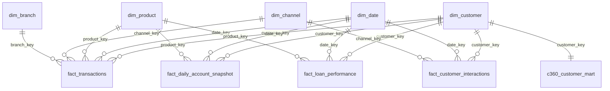

# Enterprise BFSI Customer 360 Data Product: System Architecture

An end-to-end modern data platform and analytics product designed for Tier-1 Banking, Financial Services, and Insurance (BFSI) institutions. This platform consolidates customer touchpoints, deposit accounts, lending facilities, credit cards, transactions, and CRM interactions into a unified Star Schema Enterprise Data Warehouse and real-time 360° Serving Mart.

---

## 1. High-Level System Architecture

```
                    ┌──────────────────────────────────────────────┐
                    │                Business Users                │
                    │   (Relationship Managers, Credit Risk, C-Suite)
                    └──────────────────────┬───────────────────────┘
                                           │
                                           ▼
                    ┌──────────────────────────────────────────────┐
                    │        Interactive BI Executive Portal       │
                    │     (FastAPI SPA Dashboard + Power BI)       │
                    └──────────────────────┬───────────────────────┘
                                           │
                                           ▼
                    ┌──────────────────────────────────────────────┐
                    │          Customer 360 Data REST API          │
                    │    (FastAPI, Pydantic, OpenAPI, JSON API)    │
                    └──────────────────────┬───────────────────────┘
                                           │
                                           ▼
                    ┌──────────────────────────────────────────────┐
                    │          Enterprise Data Warehouse           │
                    │         (PostgreSQL 16 / Star Schema)        │
                    │   - Conformed Dimensions (Customer, Date,    │
                    │     Product, Channel, Branch)                │
                    │   - Fact Tables (Txns, Loans, Snapshots)     │
                    │   - Consolidated C360 Serving Mart           │
                    └──────────────────────┬───────────────────────┘
                                           ▲
                                           │ (Loads & Lineage)
                    ┌──────────────────────┴───────────────────────┐
                    │               ETL / ELT Pipeline             │
                    │       (Python, SQLAlchemy, Batch Engine)     │
                    └──────────▲───────────────────────▲───────────┘
                               │                       │
                    ┌──────────┴──────────┐ ┌──────────┴───────────┐
                    │ Data Quality Layer  │ │  Data Lineage Layer  │
                    │ (15 Automated Rules │ │ (Directed DAG Graph, │
                    │  Completeness, Ref) │ │  Catalog & Freshness)│
                    └──────────▲──────────┘ └──────────────────────┘
                               │
            ┌──────────────────┼──────────────────┐
            ▼                  ▼                  ▼
    ┌──────────────┐   ┌──────────────┐   ┌──────────────┐
    │ Customer DB  │   │ Loan System  │   │ Txn & Cards  │
    │  (Core CRM & │   │  (Mortgages, │   │ (Payments,   │
    │   KYC / AML) │   │  Overdue NPL)│   │  POS, Lines) │
    └──────────────┘   └──────────────┘   └──────────────┘
```

---

## 2. Dimensional Model: Star Schema Design

The Enterprise Data Warehouse follows Kimball dimensional modeling principles:



### Table Specifications:
1. **`dim_customer`**: Conformed customer master dimension. Tracks demographic profiles, age brackets, income tiers, credit scores, KYC compliance status, and AML risk tiers.
2. **`dim_date`**: Enterprise financial calendar. Includes surrogate keys (e.g. `20261005`), day of week, month names, fiscal quarters, and weekend flags.
3. **`dim_product`**: Unified banking product catalog across Deposits (Savings, Checking, MM, CD), Lending (Mortgage, Auto, Commercial), and Credit Cards.
4. **`dim_channel`**: Omnichannel touchpoints: Mobile Banking, Web Portal, ATM, In-Branch Teller, POS, and AI Chatbot.
5. **`fact_transactions`**: Atomic transaction event fact with amounts, merchant category, timestamps, and fraud detection indicators.
6. **`fact_daily_account_snapshot`**: Periodic snapshot of account balances and accrued interest.
7. **`fact_loan_performance`**: Monthly loan status, unpaid principal, Days Past Due (DPD), NPL status, and loss provisioning.
8. **`fact_customer_interactions`**: Customer support touchpoints, resolution status, and sentiment scores (-1.0 to +1.0).
9. **`c360_customer_mart`**: Denormalized single-row-per-customer serving mart powering sub-10ms API responses and BI dashboards.

---

## 3. Answering the 6 Core Business Questions

| # | Business Question | Data Source / Fact Layer | Metric / Logic Formulation |
|---|---|---|---|
| **1** | *Which customers have multiple products?* | `c360_customer_mart` & `fact_daily_account_snapshot` + `fact_loan_performance` | `total_products_held > 1` across distinct banking categories (Omni-Banking vs Mono-Product). |
| **2** | *Which customers are high-value?* | `c360_customer_mart` | Weighted Lifetime Value score (`ltv_score >= 60`) + relationship assets (`total_relationship_value >= $75k`). |
| **3** | *Which customers have overdue loans?* | `fact_loan_performance` | `overdue_days > 0` stratified by aging buckets (1-29 DPD, 30-59 DPD, 60-89 DPD, 90+ DPD / NPL). |
| **4** | *What is the monthly transaction volume?* | `fact_transactions` & `dim_date` | Aggregated monthly volume, ticket sizes, digital vs physical channel adoption, and debit vs credit velocity. |
| **5** | *Which customers have declining engagement?* | `c360_customer_mart` & `fact_customer_interactions` | Negative average sentiment (`sentiment < -0.1`), unresolved disputes, or zero transactions in trailing 30 days. |
| **6** | *Which customer segments have the highest risk?* | `c360_customer_mart` grouped by `customer_segment` | Composite risk index combining subprime credit scores (<600), delinquency rates, and AML risk tiers. |

---

## 4. Data Quality & Governance Framework

The platform executes a 15-rule automated verification suite before warehouse loading:
- **Completeness**: Ensures non-null primary business keys (`customer_id`, `account_id`, `loan_id`, `transaction_id`).
- **Validity & Boundaries**: Ensures credit score $\in [300, 850]$, AML score $\in [0, 100]$, transaction amount $> 0$, and non-negative overdue days.
- **Referential Integrity**: Guarantees zero orphan records across accounts, loans, credit cards, and transactions.
- **Anomaly Detection**: Flags extreme transaction spikes ($>\$50,000$) and unflagged delinquent loans.

---

## 5. Technology Stack & DevOps

- **Database Engine**: PostgreSQL 16 (Enterprise Production) & SQLite 3 (Zero-config local mode)
- **Data Engineering**: Python 3.11+, SQLAlchemy ORM, Pandas, Batch ETL Pipeline
- **API Framework**: FastAPI, Pydantic v2, Uvicorn, OpenAPI / Swagger UI
- **Front-End & BI**: HTML5 Semantic Design, Modern Vanilla CSS, Chart.js, **Microsoft Power BI** (.pbids, DAX Semantic Models), and **Tableau Desktop / Server** (.tds, .twb Workbooks)
- **Containerization**: Docker, Docker Compose multi-service architecture

---

## 6. Enterprise BI Ecosystem (Power BI & Tableau)

The Customer 360 data platform provides dual, first-class support for both **Microsoft Power BI** and **Tableau Desktop / Cloud / Server**:

### BI Capabilities Comparison:
| Capability | Microsoft Power BI | Tableau Desktop & Server |
|---|---|---|
| **Connection Protocol** | DirectQuery & Import via PostgreSQL (`.pbids`) or Web JSON REST API | Live Connection & In-Memory Hyper Extract (`.tds`, `.twb`) |
| **Instant Setup** | Double-click `powerbi/bfsi_customer_360_postgres.pbids` | Double-click `tableau/bfsi_customer_360.tds` or open `.twb` |
| **Formula Language** | Certified DAX (Data Analysis Expressions) library | Certified Tableau Calculated Fields with LoD expressions |
| **Data Model** | Star Schema 1:* relationships with cross-filtering | Physical & Logical Relationships Layer with conformed dimensions |
| **REST Data Feeds** | `/api/exports/csv/customer-360-mart` | `/api/exports/csv/customer-360-mart` & `/api/exports/tableau/semantic-model` |
| **Pre-built Templates** | `powerbi/star_schema_model.json` + PBIDS | `tableau/bfsi_customer_360.twb` + `datasource_config.json` |

Both BI platforms are seamlessly linked to the central Data Quality rules, guaranteeing identical single-source-of-truth calculations across all executive reports and operational dashboards.
